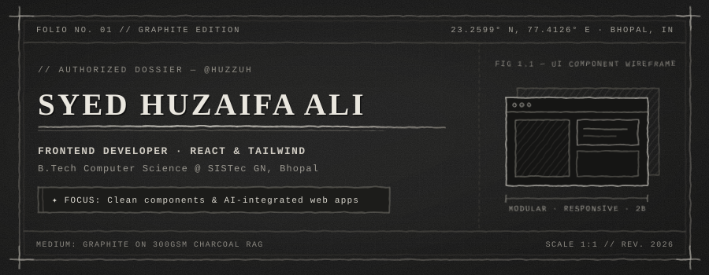
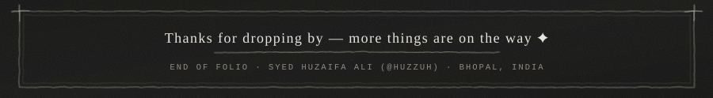

 

 

### `I.` &nbsp; FIELD NOTES &nbsp;—&nbsp; *About*

> *"Care for the details that make an interface feel right: clean components, sensible interactions, and fast load times."*

Frontend developer and **B.Tech Computer Science** student at **SISTec GN, Bhopal**. I build responsive, accessible interfaces with **React**, **Tailwind CSS**, and **JavaScript**, focusing on modular structure and deliberate UI craft.

Previously contributed hands-on to a **production-grade AI learning platform**, shipping across notes, flashcards, and chat modules. Currently working toward a **Software Engineering** role while continually expanding what I know.

| SPEC | ENTRY |
| :--- | :--- |
| **BASE** | Bhopal, India |
| **FOCUS** | Software craftsmanship · Open source · Modern frontend architecture · AI-integrated applications |
| **TRAJECTORY** | Software Engineering role — building resilient, user-centered web systems |

 

 

### `II.` &nbsp; INSTRUMENT TRAY &nbsp;—&nbsp; *Stack & Concepts*

| DISCIPLINE | TOOLS & INSTRUMENTS |
| :--- | :--- |
| **Interface & Styling** |  &nbsp;  &nbsp;  &nbsp;  |
| **Languages** |  &nbsp;  &nbsp;  &nbsp;  |
| **Source & Workflow** |  &nbsp;  |
| **Core Concepts** | `Responsive web design` &nbsp;·&nbsp; `REST API integration` &nbsp;·&nbsp; `Component-based architecture` &nbsp;·&nbsp; `Version control` |

 

 

### `III.` &nbsp; STUDIO ARCHIVE &nbsp;—&nbsp; *Work & Repositories*

#### `00` · FEATURED COMMISSION *(PRIVATE PROJECT)*
> **Frontend Developer — Retro AI Learning Platform** &nbsp;`[ 2024 – 2025 ]`
>
> Built responsive UI components and full application layouts for an AI-powered study workspace — smart **Notes**, **Flashcards**, contextual **Chat**, and productivity dashboards. Integrated frontend views with REST APIs and AI-driven workflows alongside the backend team, keeping the codebase modular and readable with React components and Tailwind utilities.

 

#### `01–06` · PUBLIC REPOSITORY LEDGER

| NO. | REPOSITORY | SPECIFICATION & NOTES |
| :---: | :--- | :--- |
| `01` | **[Hunar-Vikas-Frontend](https://github.com/huzzuh/Hunar-Vikas-Frontend)** | Frontend for Hunar Vikas, Maharashtra Skills and Livelihoods. *(`TypeScript`)* |
| `02` | **[js-rev-simon-says](https://github.com/huzzuh/js-rev-simon-says)** | JavaScript revision project with mini projects, including a Simon Says memory game. |
| `03` | **[js-revision-simon-says](https://github.com/huzzuh/js-revision-simon-says)** | Simon Says game in HTML, CSS and JavaScript — DOM manipulation, events and game logic. |
| `04` | **[Python-Project](https://github.com/huzzuh/Python-Project)** | A Python tool that analyses GitHub profiles. |
| `05` | **[mp-site](https://github.com/huzzuh/mp-site)** | A small static site. |
| `06` | **[test-verification](https://github.com/huzzuh/test-verification)** | Experiments and verification scripts. |

 

 

### `IV.` &nbsp; TELEMETRY &nbsp;—&nbsp; *GitHub Signal*

&nbsp;

 

 

### `V.` &nbsp; CHRONICLE & MARGIN NOTES &nbsp;—&nbsp; *Education & Now*

#### ACADEMIC RECORD

| PERIOD | QUALIFICATION | INSTITUTION & SCORE |
| :--- | :--- | :--- |
| `2023 – 2027` | **B.Tech, Computer Science** *(expected)* | **SISTec GN** *(Sagar Institute of Science, Technology & Engineering with Research)*, Bhopal |
| `2022 – 2023` | **Class XII, CBSE** | **79.9%** |
| `2020 – 2021` | **Class X, CBSE** | **76%** |

 

#### CURRENT MARGIN NOTES

- `◈` &nbsp;Working through **B.Tech**, sharpening frontend fundamentals
- `◇` &nbsp;Exploring **open source**, frontend architecture, and **AI-integrated apps**
- `△` &nbsp;**Long-term:** contributing meaningfully to large-scale engineering teams
- `✦` &nbsp;**Belief:** the best engineers never stop learning

 

 

### `VI.` &nbsp; CORRESPONDENCE &nbsp;—&nbsp; *Connect*

&nbsp;&nbsp;

  

