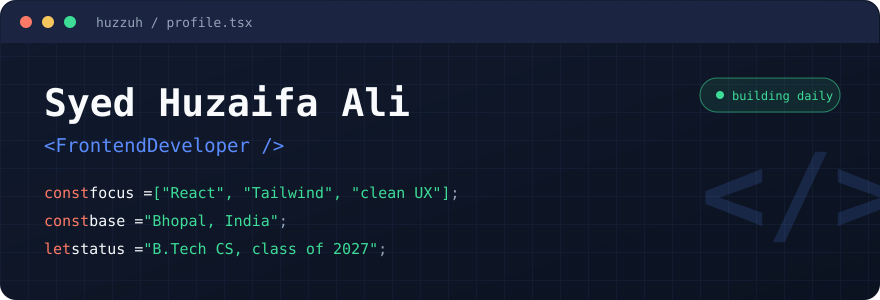

 

  
    <strong>Bhopal, India</strong> &nbsp;✦&nbsp;
    Software Craftsmanship &nbsp;·&nbsp; Open Source &nbsp;·&nbsp; Modern Frontend Architecture &nbsp;·&nbsp; AI-Integrated Apps
  

  
  &nbsp;
  

 

  ✦ &nbsp; 01 &nbsp; ✦
  <h3><code>&lt;about /&gt;</code> &nbsp;&amp;&nbsp; <code>&lt;now /&gt;</code></h3>

<table>
  <tr>
    <td width="60%" valign="top">
      

        Frontend developer and B.Tech Computer Science student at <strong>SISTec GN, Bhopal</strong>. I build responsive, accessible interfaces with <strong>React</strong>, <strong>Tailwind CSS</strong> and <strong>JavaScript</strong> — and I care about the details that make an interface feel right: clean components, sensible interactions, and fast load times.
      

      

        I got hands-on experience on a production-grade AI learning platform, working across notes, flashcards and chat modules. Now I'm working toward a Software Engineering role, and I'm always looking for the next thing to learn.
      

      

        
          <strong>Based in</strong> Bhopal, India &nbsp;·&nbsp; <strong>Interested in</strong> software craftsmanship, open source, modern frontend architecture and AI-integrated applications.
        
      

    </td>
    <td width="40%" valign="top">
      
<strong><code>// current_focus</code></strong>

      

        🎓 &nbsp;Working through B.Tech, sharpening frontend fundamentals  
        🧩 &nbsp;Exploring open source, frontend architecture and AI-integrated apps  
        🌱 &nbsp;Long-term: contributing meaningfully to large-scale engineering teams  
        ✦ &nbsp;<em>Belief: the best engineers never stop learning</em>
      

    </td>
  </tr>
</table>

 

 

  ✦ &nbsp; 02 &nbsp; ✦
  <h3><code>&lt;stack /&gt;</code></h3>

<table align="center">
  <tr>
    <td align="center" width="22%"><strong><code>Frontend</code></strong></td>
    <td align="left">
      
      
      
      
    </td>
  </tr>
  <tr>
    <td align="center"><strong><code>Languages</code></strong></td>
    <td align="left">
      
      
      
      
    </td>
  </tr>
  <tr>
    <td align="center"><strong><code>Workflow</code></strong></td>
    <td align="left">
      
      
    </td>
  </tr>
  <tr>
    <td align="center"><strong><code>Concepts</code></strong></td>
    <td align="left">
      <kbd>Responsive web design</kbd> &nbsp;
      <kbd>REST API integration</kbd> &nbsp;
      <kbd>Component-based architecture</kbd> &nbsp;
      <kbd>Version control</kbd>
    </td>
  </tr>
</table>

 

 

  ✦ &nbsp; 03 &nbsp; ✦
  <h3><code>&lt;work /&gt;</code></h3>

<table>
  <tr>
    <td width="100%">
      <strong>✦ Frontend Developer — Retro AI Learning Platform</strong> &nbsp;<code>2024–2025</code> &nbsp;<em>(private project)</em>
        
      Built responsive UI components and full application layouts for an AI-powered study workspace — smart Notes, Flashcards, contextual Chat and productivity dashboards. Integrated frontend views with REST APIs and AI-driven workflows alongside the backend team, and kept the codebase modular and readable with React components and Tailwind utilities.
        
      <kbd>React</kbd> &nbsp;<kbd>Tailwind CSS</kbd> &nbsp;<kbd>REST APIs</kbd> &nbsp;<kbd>AI Workflows</kbd>
    </td>
  </tr>
</table>

 

<strong>PUBLIC REPOSITORIES</strong>

<table>
  <tr>
    <td width="50%" valign="top">
      <strong>◈ <a href="https://github.com/huzzuh/Hunar-Vikas-Frontend">Hunar-Vikas-Frontend</a></strong> &nbsp;<kbd>TypeScript</kbd>
        
      Frontend for Hunar Vikas, Maharashtra Skills and Livelihoods.
    </td>
    <td width="50%" valign="top">
      <strong>◈ <a href="https://github.com/huzzuh/Python-Project">Python-Project</a></strong> &nbsp;<kbd>Python</kbd>
        
      A Python tool that analyses GitHub profiles.
    </td>
  </tr>
  <tr>
    <td width="50%" valign="top">
      <strong>◈ <a href="https://github.com/huzzuh/js-rev-simon-says">js-rev-simon-says</a></strong> &nbsp;<kbd>JavaScript</kbd>
        
      JavaScript revision project with mini projects, including a Simon Says memory game.
    </td>
    <td width="50%" valign="top">
      <strong>◈ <a href="https://github.com/huzzuh/js-revision-simon-says">js-revision-simon-says</a></strong> &nbsp;<kbd>HTML · CSS · JS</kbd>
        
      Simon Says game in HTML, CSS and JavaScript — DOM manipulation, events and game logic.
    </td>
  </tr>
  <tr>
    <td width="50%" valign="top">
      <strong>◈ <a href="https://github.com/huzzuh/mp-site">mp-site</a></strong> &nbsp;<kbd>Static Web</kbd>
        
      A small static site.
    </td>
    <td width="50%" valign="top">
      <strong>◈ <a href="https://github.com/huzzuh/test-verification">test-verification</a></strong> &nbsp;<kbd>Scripts</kbd>
        
      Experiments and verification scripts.
    </td>
  </tr>
</table>

 

 

  ✦ &nbsp; 04 &nbsp; ✦
  <h3><code>&lt;signal /&gt;</code></h3>
   
  

    
    &nbsp;
    
  

 

 

  ✦ &nbsp; 05 &nbsp; ✦
  <h3><code>&lt;education /&gt;</code></h3>

<table align="center">
  <thead>
    <tr>
      <th align="left">Program</th>
      <th align="left">Institution / Board</th>
      <th align="center">Period</th>
      <th align="center">Result</th>
    </tr>
  </thead>
  <tbody>
    <tr>
      <td><strong>B.Tech, Computer Science</strong></td>
      <td>SISTec GN (Sagar Institute of Science, Technology &amp; Engineering with Research), Bhopal</td>
      <td align="center"><code>2023–2027</code></td>
      <td align="center">Expected</td>
    </tr>
    <tr>
      <td><strong>Class XII</strong></td>
      <td>CBSE</td>
      <td align="center"><code>2022–2023</code></td>
      <td align="center"><strong>79.9%</strong></td>
    </tr>
    <tr>
      <td><strong>Class X</strong></td>
      <td>CBSE</td>
      <td align="center"><code>2020–2021</code></td>
      <td align="center"><strong>76%</strong></td>
    </tr>
  </tbody>
</table>

 

 

  ✦ &nbsp; 06 &nbsp; ✦
  <h3><code>&lt;contact /&gt;</code></h3>

  

    
    &nbsp;
    
  

   

  

